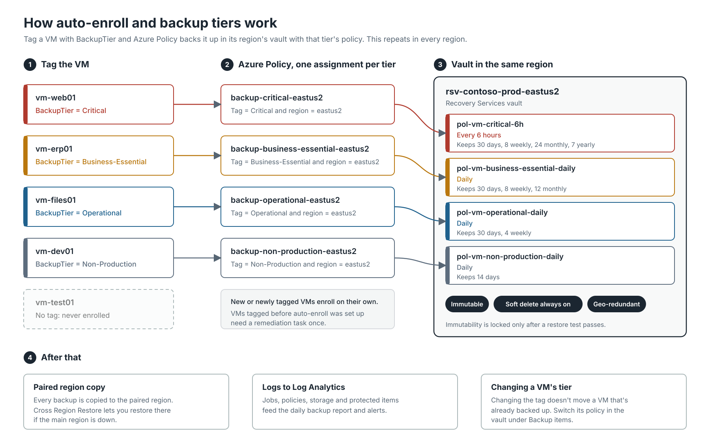

# Immutable Azure Backup Vaults with Auto-Enroll Tiers

Bicep that builds Recovery Services vaults whose backups can't be deleted early, even by an admin, with VM backup policies split into four tiers. Azure Policy then puts every tagged VM into its region's vault and the right tier's policy on its own.

You deploy everything from Azure Cloud Shell, one region at a time. The names, regions and tier values here are examples, so change them to fit your environment.



## What it does

Each vault gets:

| Setting | What it does |
|---|---|
| Geo-redundant storage | Keeps a copy of every backup in the paired region |
| Cross Region Restore | Lets you restore in the paired region if the main one goes down |
| Immutability, turned on but not locked | Stops anyone deleting recovery points before they expire |
| Always-on soft delete | Keeps deleted backups for 14 more days by default. It can't be turned off. |
| Diagnostic setting | Sends backup logs to Log Analytics for reports and alerts |
| Four backup policies | One per tier, built from [`config/backup-tiers.json`](config/backup-tiers.json) |

The tiers:

| Tier | What goes here | Backups | Kept for |
|---|---|---|---|
| Critical | Public-facing, financial, identity | Every 6 hours | 30 days, 8 weekly, 24 monthly, 7 yearly |
| Business-Essential | Internal apps people need every day | Daily | 30 days, 8 weekly, 12 monthly |
| Operational | File servers, jump boxes, tooling | Daily | 30 days, 4 weekly |
| Non-Production | Dev, test, sandbox | Daily | 14 days |

Every vault gets the same policy names, so the same tag works in every region.

Auto-enroll adds one Azure Policy assignment per tier in each region. When a VM is created or tagged with `BackupTier = Critical`, the Critical assignment for its region turns on backup in that region's vault with the Critical policy. [How the tiering works](docs/how-tiering-works.md) covers exactly when a VM is enrolled, what happens when a tag changes, and which VMs it can't pick up.

There's also a script that locks immutability once you've tested a restore, and a restore test runbook.

## Permissions

| Who | Role | Where it's assigned | Why |
|---|---|---|---|
| You, to deploy | Contributor | The resource group for each vault | To create the vault, its policies and its diagnostic setting |
| You, to deploy | Log Analytics Contributor | The Log Analytics workspace | To let the vault send logs to it |
| You, to tag VMs | Tag Contributor | The VMs or their resource groups | To add the `BackupTier` tag |
| You, to set up auto-enroll | Resource Policy Contributor | Each subscription | To assign the Azure Policy |
| You, to set up auto-enroll | Owner, User Access Administrator, or Role Based Access Control Administrator | Each subscription | To give the policy's managed identity its roles |
| Each auto-enroll assignment's managed identity | Virtual Machine Contributor | Each subscription | To turn on backup for tagged VMs. The auto-enroll deployment gives this for you. |
| Each auto-enroll assignment's managed identity | Backup Contributor | The vault's resource group | To add VMs to the vault. The auto-enroll deployment gives this for you. |
| You, to test a restore | Backup Operator | The vault | To start the restore |
| You, to test a restore | Virtual Machine Contributor | The VM that was backed up | Restores read settings from the original VM |
| You, to test a restore | Contributor | The resource group the test VM goes in | To create the restored VM and connect it to the test network |
| You, to test a restore | Storage Account Contributor | The staging storage account | Restores copy data through it |
| You, to lock immutability | Contributor, or Backup Contributor plus Tag Contributor | The vault | To lock the vault and write the lock details into its tags |

A managed identity is an account Azure creates for each policy assignment, so it can make changes without a stored password. Backup Contributor can't create vaults, which is why deploying needs Contributor.

## What to change for your environment

| Setting | What to put in |
|---|---|
| `scopeName` | In each file in `infrastructure/environments`. A short name for the subscription or workload, up to 20 characters, like `contoso-prod`. It goes into the vault name. |
| `location` | In each file in `infrastructure/environments`. The region, like `eastus2`. Rename the file to match if you change it. |
| `workspaceId` | In each file in `infrastructure/environments`. Resource ID of your Log Analytics workspace. Find it on the workspace under Overview → JSON View. It starts with `/subscriptions/`. Leave it as `''` to skip logs. |
| `softDeleteRetentionDays` | In each file in `infrastructure/environments`. How many days deleted backups are kept, 14 to 180. Default is `14`. |
| `disablePublicNetworkAccess` | In each file in `infrastructure/environments`. `true` blocks public access to the vault. Only use it if you've set up private endpoints for backup. Default is `false`. |
| `vaultName` | Optional, add it to the `.bicepparam` file. Default is `rsv-<scopeName>-<location>`. |
| `tags` | Optional, add it to the `.bicepparam` file. Tags on the vault, like `{ workload: 'backup', owner: 'it@contoso.com' }`. |
| `diagnosticSettingName` and `logCategories` | Optional, add them to the `.bicepparam` file. The defaults send the backup log categories the [Daily Azure Backup Report](https://github.com/RaeRucker/azure-backup-daily-report) reads. |
| Resource group names | In the Step 3 commands. Default is `rg-backup-<region>`. |
| Tier schedules and retention | In `config/backup-tiers.json`. `startTimeUtc` is the backup time in UTC as `HH:MM`, on the hour or half hour. `everyHours` and `windowHours` are only for the Critical tier's hourly schedule. `instantRestoreDays` is 1 to 5 for daily tiers and 1 to 30 for Critical. `retention` is days, weeks, months and years, with `0` for none. |
| Tier RPO and RTO targets | In `config/backup-tiers.json`, under `targets`. Hours. The tests check them against the schedule. |
| Policy names | In `config/backup-tiers.json`, `policyName`. Keep them the same in every vault so auto-enroll works everywhere. |
| VM tag | The tag name is `BackupTier`, set in `config/backup-tiers.json` as `tagName`. Values must match a tier `name` exactly, like `Critical`. |
| Auto-enroll `location`, `vaultResourceGroupName` and `vaultName` | In each `infrastructure/environments/auto-enroll-<region>.bicepparam` file. The region, and the name and resource group of that region's vault. |
| Auto-enroll `effect` | In the same files. `DeployIfNotExists` turns backup on. `AuditIfNotExists` only reports what would be enrolled. |
| `-ResourceGroupName` and `-VaultName` | When you run the lock script. The vault's resource group and name. `-VaultName` takes more than one name. |
| `-RestoreTestReference` | When you run the lock script. The ID of your passed restore test, 3 to 64 letters, numbers, dots, dashes or underscores, like `CHG-2026-0412`. |
| `-LockedByTagName`, `-LockedOnTagName`, `-EvidenceTagName` | Optional, when you run the lock script. The tag names it writes on the vault. Defaults are `immutabilityLockedBy`, `immutabilityLockedOn` and `immutabilityEvidence`. |

## Setup

### Step 1. Get the files into Cloud Shell

1. Sign in to the Azure portal.
2. Click the Cloud Shell icon in the top bar. It looks like `>_`.
3. Pick Bash if it asks.
4. Run:

   ```bash
   git clone https://github.com/RaeRucker/azure-immutable-backup-vaults
   cd azure-immutable-backup-vaults
   ```

You should see a new `azure-immutable-backup-vaults` folder when you run `ls`.

### Step 2. Fill in your settings

There's one settings file per region in `infrastructure/environments`.

1. Run `code infrastructure/environments/eastus2.bicepparam` to open it in the Cloud Shell editor.
2. Set `scopeName`, `workspaceId` and the other values using the table in [What to change for your environment](#what-to-change-for-your-environment).
3. Press Ctrl+S to save, then Ctrl+Q to close.
4. Do the same for `centralus.bicepparam`. If you use other regions, rename the files and change `location` inside them.
5. If you want different schedules or retention, edit `config/backup-tiers.json` the same way.

### Step 3. Preview, then deploy

1. Create the resource groups and preview the changes:

   ```bash
   for region in eastus2 centralus; do
     az group create -n "rg-backup-$region" -l "$region"
     az deployment group what-if -g "rg-backup-$region" --template-file infrastructure/main.bicep \
       --parameters "infrastructure/environments/$region.bicepparam"
   done
   ```

2. Read the preview. `what-if` only shows what would be created. You should see one vault, four backup policies and one diagnostic setting per region.
3. If it looks right, deploy:

   ```bash
   for region in eastus2 centralus; do
     az deployment group create -g "rg-backup-$region" --template-file infrastructure/main.bicep \
       --parameters "infrastructure/environments/$region.bicepparam"
   done
   ```

Each deployment should end with `"provisioningState": "Succeeded"`.

### Step 4. Check the vault

1. In the portal search bar, type Recovery Services vaults and open the new vault.
2. Go to Settings → Properties. Under Backup Configuration, storage redundancy should say Geo-redundant and Cross Region Restore should say Enabled.
3. On the same page, Immutable vault should say Enabled and not locked.
4. On the same page, under Security Settings, soft delete should be on with always-on soft delete ticked.
5. Go to Manage → Backup policies. You should see four policies, one per tier.

### Step 5. Tag your VMs

1. Open a VM and go to Tags.
2. Add the name `BackupTier` with one of these values: `Critical`, `Business-Essential`, `Operational` or `Non-Production`.
3. Click Apply.

### Step 6. Turn on auto-enroll

1. Open each `infrastructure/environments/auto-enroll-<region>.bicepparam` file with `code`, set the vault name and resource group from Step 3, then save.
2. Preview:

   ```bash
   for region in eastus2 centralus; do
     az deployment sub what-if -l "$region" --template-file infrastructure/auto-enroll.bicep \
       --parameters "infrastructure/environments/auto-enroll-$region.bicepparam"
   done
   ```

   You should see four policy assignments per region, plus their role assignments.
3. Deploy by running the same loop with `create` in place of `what-if`.
4. In the portal, open Policy → Authoring → Assignments. You should see `backup-critical-eastus2` and the rest, one per tier per region.
5. VMs you tagged in Step 5 before this step need a one-time remediation task. Wait 10 minutes, then follow [Step 4 of the auto-enroll guide](docs/auto-enroll-with-azure-policy.md#step-4-enroll-vms-that-were-already-tagged).

From now on, new VMs and newly tagged VMs enroll on their own, usually within about 30 minutes. The [auto-enroll guide](docs/auto-enroll-with-azure-policy.md) also has a portal-only way to do this, coverage queries, and how to leave VMs out.

### Step 7. Test a restore

Wait until each tier has a few days of backups, then follow the [restore test runbook](runbooks/backup-restore-validation.md). Don't skip this. You need a passed restore test before step 8.

### Step 8. Lock immutability

This can't be undone. Once a vault is locked, nobody can shorten its retention for as long as the vault exists. If a policy keeps backups too long, you pay for that storage until each backup expires. Don't lock test vaults.

1. Open Cloud Shell and pick PowerShell this time.
2. Run `cd azure-immutable-backup-vaults`.
3. Do a dry run first. `-WhatIf` shows what would happen without changing anything:

   ```powershell
   ./scripts/Lock-VaultImmutability.ps1 -ResourceGroupName rg-backup-eastus2 -VaultName rsv-contoso-prod-eastus2 -RestoreTestReference CHG-2026-0412 -WhatIf
   ```

4. Run it again without `-WhatIf` and answer the two prompts.
5. In the portal, open the vault and go to Settings → Properties. Immutable vault should now say Enabled and locked. The vault's tags should show who locked it, when, and your restore test ID.

The script won't lock a vault that isn't geo-redundant, doesn't have immutability turned on, or has no protected VMs yet.

## Changing a tier later

1. Edit `config/backup-tiers.json`.
2. Run the Step 3 commands again. The deployment updates the policies in every vault.
3. Rebuild the diagram so it matches. See [Files](#files).

On an immutable vault you can make retention longer and change the schedule, but you can't make retention shorter. Azure blocks that.

To move one VM to a different tier, changing its tag isn't enough. See [Moving a VM to a different tier](docs/how-tiering-works.md#moving-a-vm-to-a-different-tier).

## If something goes wrong

| What you see | What to check |
|---|---|
| Deployment fails with AuthorizationFailed | You're missing Contributor on the resource group or Log Analytics Contributor on the workspace |
| Deployment fails on the diagnostic setting | Check `workspaceId`. It has to be the full resource ID, not just the workspace name. |
| Deployment fails when changing a policy | You made retention shorter on an immutable vault. Azure only allows longer retention. |
| Storage redundancy can't be changed | It can't change once the first backup is configured. If the vault is still empty, delete it and deploy again. |
| A tagged VM isn't getting backed up | Check the tag spelling and the VM's region. If it was tagged before Step 6, run a remediation task. [How the tiering works](docs/how-tiering-works.md#what-happens-to-a-vm) lists the cases auto-enroll can't pick up. |
| A VM stayed on its old tier after you changed the tag | That's expected. See [Moving a VM to a different tier](docs/how-tiering-works.md#moving-a-vm-to-a-different-tier). |
| Secondary Region shows no backup items | Items can take up to 48 hours to show up after Cross Region Restore is turned on |
| The lock script won't lock | Read the warning. It says which check failed. |
| The lock script fails on `Update-AzTag` | The vault is already locked, but you don't have Tag Contributor. Add the three tags by hand under the vault's Tags. |

## How it's built

`infrastructure/main.bicep` reads the tiers from `config/backup-tiers.json` and creates one backup policy per tier in a loop. You deploy it once per region with that region's `.bicepparam` file.

`infrastructure/auto-enroll.bicep` reads the same config and creates one policy assignment per tier, at subscription scope, for one region. Each assignment matches VMs in that region with that tier's tag and points at that tier's backup policy in that region's vault. It also gives each assignment's identity the two roles the built-in policy needs, with Backup Contributor limited to the vault's resource group.

A few choices worth explaining:

- Vaults are deployed unlocked. Locking is a separate script that needs a restore test ID first. See [design decision 1](docs/design-decisions/0001-lock-immutability-separately.md).
- There's one geo-redundant vault per region because a VM can only back up to a vault in its own region. See [design decision 2](docs/design-decisions/0002-one-geo-redundant-vault-per-region.md).
- The Critical tier uses an Enhanced policy, which is the only type that can back up more than once a day.
- Logs go to resource-specific tables in Log Analytics, which is what Azure Backup reports read.

[Recovery objectives](docs/recovery-objectives.md) has the RPO and RTO targets per tier. RPO is how much data you can lose. RTO is how long recovery can take.

## Cost

Most of the cost is backup storage. Geo-redundant storage costs more than locally redundant storage, and Cross Region Restore adds its own charge. Long yearly retention on the Critical tier is what grows the bill over time, so set it from a real requirement. See [Azure Backup pricing](https://azure.microsoft.com/pricing/details/backup/).

To delete a vault that isn't locked, turn off immutability, stop backup and delete the backup data. Always-on soft delete then keeps that data for the soft delete period before it's gone.

## Files

| File | What it is |
|---|---|
| `infrastructure/main.bicep` | The vault, its policies and its diagnostic setting |
| `infrastructure/auto-enroll.bicep` | The Azure Policy assignments and roles for one region |
| `infrastructure/modules/vault-role.bicep` | Gives an assignment's identity a role on the vault's resource group |
| `infrastructure/environments/<region>.bicepparam` | Vault settings for each region |
| `infrastructure/environments/auto-enroll-<region>.bicepparam` | Auto-enroll settings for each region |
| `config/backup-tiers.json` | Tier schedules, retention and recovery targets |
| `scripts/Lock-VaultImmutability.ps1` | Locks immutability after a restore test |
| `docs/how-tiering-works.md` | When a VM is enrolled, what happens when a tag changes, and the limits |
| `docs/auto-enroll-with-azure-policy.md` | Auto-enroll setup, coverage queries and exclusions |
| `docs/images/how-it-works.png` | The diagram at the top of this page |
| `tools/build_diagram.py` | Rebuilds the diagram from `config/backup-tiers.json`. Run `python tools/build_diagram.py config/backup-tiers.json /tmp/d.svg` then `rsvg-convert /tmp/d.svg -o docs/images/how-it-works.png` |
| `docs/recovery-objectives.md` | RPO and RTO targets per tier |
| `docs/design-decisions/` | Why the vaults are built the way they are |
| `runbooks/backup-restore-validation.md` | How to test a restore |
| `tests/Vaults.Tests.ps1` | Pester tests for the config, template, script and docs |
| `bicepconfig.json` | Bicep linter rules |

## Checks

CI runs on every push to main and on every pull request. It fails if any of these happen:

- `main.bicep`, `auto-enroll.bicep` or any `.bicepparam` file doesn't build, or the Bicep linter reports an error
- PSScriptAnalyzer finds a warning or error in `scripts` or `tests`
- a Pester test fails
- gitleaks finds a secret

The Pester tests compile the Bicep and check that:

- there are four tiers with different policy names
- each tier's RPO target isn't shorter than the time between its backups
- instant restore days are within what each policy type allows
- a more critical tier never has weaker targets or shorter daily retention than the tier below it
- the vault has geo-redundant storage, Cross Region Restore, immutability and always-on soft delete
- nothing in the template locks a vault
- auto-enroll creates one assignment per tier with the built-in tag policy, matches the tier tag, points each tier at its own backup policy, and grants the two roles the policy needs
- logs go to resource-specific tables
- the lock script asks for confirmation, supports `-WhatIf` and requires a restore test ID
- every relative link in the docs works

To run them yourself you need PowerShell 7, Pester and the Bicep CLI:

```powershell
Invoke-Pester ./tests -Output Detailed
```

## Known gaps

- I haven't deployed this exact template. Bicep checks the template, but Azure hasn't accepted it yet.
- Weekly, monthly and yearly backups are kept from Sunday, the first Sunday of the month, and the first Sunday of January. Those are set in `main.bicep`, not the tier config.
- Policy times are in UTC.
- Cross Region Restore can lag up to 36 hours, which is longer than the 24 hour RPO targets.
- The lock script only counts protected Azure VMs.
- Auto-enroll can't move a VM that's already backed up to a different tier, and it doesn't match VMs built from custom or gallery images. Both are covered in [How the tiering works](docs/how-tiering-works.md).
- Auto-enroll works one subscription at a time. Deploy it in each subscription that has VMs.
- Azure SQL and PostgreSQL backups aren't covered. Those are set up on the database side.
