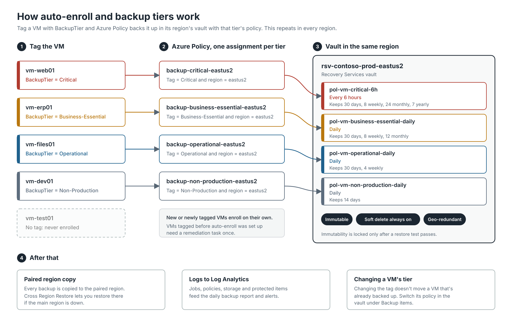

# Auto-enroll VMs into the right backup tier

With this set up, a VM tagged `BackupTier = Critical` gets backed up by the Critical policy in its region's vault without anyone clicking Enable backup. The same goes for the other tiers. [How the tiering works](how-tiering-works.md) explains exactly when a VM gets enrolled and when it doesn't.



Each region gets one Azure Policy assignment per tier. Every assignment uses Microsoft's built-in policy Configure backup on virtual machines with a given tag to an existing recovery services vault in the same location. It's pointed at that region's vault and that tier's backup policy. With four tiers and two regions, that's eight assignments.

## Permissions

| Who | Role | Where it's assigned | Why |
|---|---|---|---|
| You | Resource Policy Contributor | The subscription | To create the policy assignments |
| You | User Access Administrator, Role Based Access Control Administrator, or Owner | The subscription | To give each assignment's managed identity its roles |
| Each assignment's managed identity | Virtual Machine Contributor | The subscription | To turn on backup for each tagged VM |
| Each assignment's managed identity | Backup Contributor | The vault's resource group | To add the VM to the vault |
| You, to tag VMs | Tag Contributor | The VMs or their resource groups | To add the `BackupTier` tag |

A managed identity is an account Azure creates for each policy assignment, so it can make changes without a stored password. Option A gives these roles for you. In Option B the portal does it.

## What to change for your environment

These go in `infrastructure/environments/auto-enroll-<region>.bicepparam`, one file per region.

| Setting | What to put in |
|---|---|
| `location` | The region this file covers, like `eastus2`. Only VMs in this region are enrolled. |
| `vaultResourceGroupName` | The resource group of this region's vault. Default is `rg-backup-<region>`, matching the main setup. |
| `vaultName` | This region's vault. Default is `rsv-contoso-prod-<region>`. Match it to the `scopeName` you used. |
| `effect` | `DeployIfNotExists` turns backup on. `AuditIfNotExists` only reports what would be enrolled, which is a safe way to preview. |
| `assignmentPrefix` | Optional. The start of each assignment name. Default is `backup`, giving names like `backup-critical-eastus2`. |

The tag name and the tier names come from `config/backup-tiers.json`, so they always match the backup policies.

## Step 1. Make sure the vaults exist

Auto-enroll points at vaults and backup policies that are already there. Finish Steps 1 to 4 of the [main setup](../README.md#setup) first.

## Step 2. Tag the VMs

1. Open a VM and go to Tags.
2. Add the name `BackupTier` with one of these values: `Critical`, `Business-Essential`, `Operational` or `Non-Production`.
3. Click Apply.

The value has to match a tier name exactly. A VM without the tag is never enrolled.

If you want every new VM to have the tag, assign the built-in policy Require a tag on resources. If you set tiers per resource group, use Inherit a tag from the resource group if missing.

## Step 3. Deploy auto-enroll

### Option A: Bicep from Cloud Shell

1. Open Cloud Shell in the portal and pick Bash.
2. Run `cd azure-immutable-backup-vaults`. If the folder isn't there, clone the repo again as in the main setup.
3. Run `code infrastructure/environments/auto-enroll-eastus2.bicepparam`, set the values from the table above, then press Ctrl+S and Ctrl+Q. Do the same for the other region's file.
4. Preview:

   ```bash
   for region in eastus2 centralus; do
     az deployment sub what-if -l "$region" --template-file infrastructure/auto-enroll.bicep \
       --parameters "infrastructure/environments/auto-enroll-$region.bicepparam"
   done
   ```

   You should see four policy assignments, four role assignments and four nested deployments for each region.
5. Deploy:

   ```bash
   for region in eastus2 centralus; do
     az deployment sub create -l "$region" --template-file infrastructure/auto-enroll.bicep \
       --parameters "infrastructure/environments/auto-enroll-$region.bicepparam"
   done
   ```

   Each one should end with `"provisioningState": "Succeeded"`.

### Option B: In the portal

Do this once for each tier in each region.

1. In the portal, open Policy → Authoring → Definitions.
2. Set the Category filter to Backup.
3. Open Configure backup on virtual machines with a given tag to an existing recovery services vault in the same location, then click Assign.
4. On Basics, set Scope to the subscription. Name the assignment `backup-<tier>-<region>`, like `backup-critical-eastus2`.
5. On Parameters, untick Only show parameters that need input or review, then set:
   - Location: the region, like `eastus2`
   - Inclusion Tag Name: `BackupTier`
   - Inclusion Tag Values: `["Critical"]`
   - Backup Policy: `pol-vm-critical-6h` from that region's vault
6. On Remediation, leave Create a Managed Identity ticked and pick the same region.
7. Click Review + create, then Create.

## Step 4. Enroll VMs that were already tagged

The assignments pick up new VMs and newly tagged VMs on their own. VMs that already had the tag before Step 3 need a remediation task once.

Wait 10 minutes after Step 3 so the new roles take effect. Then for each assignment:

1. In the portal, open Policy → Remediation.
2. On the Policies to remediate tab, click the assignment, like `backup-critical-eastus2`.
3. Click Remediate.
4. Check that the scope is the subscription, then click Remediate again.
5. Watch the task on the Remediation tasks tab. When it says Complete, open Backup center or the vault, and the VMs should show under Backup items.

The first backup runs at the policy's next scheduled time.

## Step 5. Check coverage

Policy → Compliance shows tagged VMs that still aren't backed up.

To find VMs with no tier tag, open Resource Graph Explorer in the portal and run:

```kusto
resources
| where type =~ 'microsoft.compute/virtualmachines'
| where isempty(tags.BackupTier)
| where resourceGroup !startswith 'mc_'
| project subscriptionId, resourceGroup, name, location
```

To find VMs that aren't backed up at all, including ones auto-enroll can't match, like VMs built from custom images:

```kusto
resources
| where type =~ 'microsoft.compute/virtualmachines'
| extend vmId = tolower(id)
| join kind=leftouter (
    recoveryservicesresources
    | where type =~ 'microsoft.recoveryservices/vaults/backupfabrics/protectioncontainers/protecteditems'
    | where properties.backupManagementType == 'AzureIaasVM'
    | extend vmId = tolower(tostring(properties.sourceResourceId))
    | project vmId, protectedBy = tostring(properties.policyName)
  ) on vmId
| where isempty(protectedBy)
| project subscriptionId, resourceGroup, name, location, tier = tostring(tags.BackupTier)
```

To save either result, click Download as CSV.

## Leaving VMs out

Only tagged VMs are enrolled, so the simplest way to leave a VM out is to not tag it. If a tag policy copies tags down from resource groups, some VMs may get a tag you didn't mean them to have. Use a policy exemption for those.

| What | Why leave it out | How |
|---|---|---|
| AKS node resource groups, the ones that start with `MC_` | AKS rebuilds the nodes. Back up the cluster with AKS backup instead. | Exemption on the `MC_` resource groups, category Waiver |
| Build agents and scale set instances | They're rebuilt from images | Don't tag them |

To add an exemption, open the assignment under Policy → Authoring → Assignments and click Create exemption. Exemptions show up in compliance reports with a reason, so anyone can see the exclusion was on purpose.

## If something goes wrong

| What you see | What to check |
|---|---|
| The deployment fails with AuthorizationFailed on a role assignment | You need User Access Administrator, Role Based Access Control Administrator or Owner on the subscription |
| The deployment fails because the backup policy wasn't found | The vault name, resource group or region in the `.bicepparam` file doesn't match the vault. Check Step 1. |
| A tagged VM isn't enrolled after an hour | Check the tag spelling and the VM's region. If it was tagged before Step 3, run Step 4. |
| The remediation task fails | Open the task and check the error. If you ran it right after Step 3, the roles may not have taken effect yet. Wait 10 minutes and run it again. |
| A VM never shows as non-compliant even though it isn't backed up | It was probably built from a custom or gallery image, which the built-in policy doesn't match. Turn on backup by hand. |
| A VM is on the wrong tier | Changing the tag doesn't move a VM that's already backed up. See [Moving a VM to a different tier](how-tiering-works.md#moving-a-vm-to-a-different-tier). |
