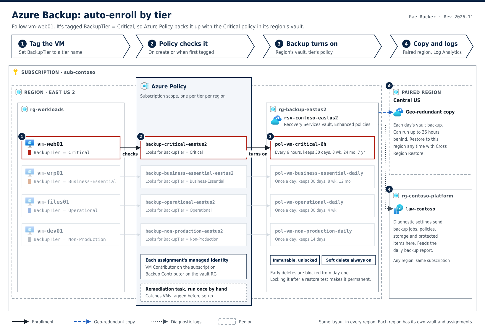

# How the tiering works

A VM's backup tier comes from one tag, `BackupTier`. Azure Policy reads that tag and turns on backup with the matching policy in the vault in the VM's region. Nobody has to click Enable backup.

## The pieces

| Piece | What it is | Where it comes from |
|---|---|---|
| Tier | A name like `Critical` with a backup schedule and retention | `config/backup-tiers.json` |
| Backup policy | One per tier, with the same name in every vault, like `pol-vm-critical-6h` | `infrastructure/main.bicep` |
| Vault | One per region, like `rsv-contoso-eastus2` | `infrastructure/main.bicep` |
| Policy assignment | One per tier per region, like `backup-critical-eastus2` | `infrastructure/auto-enroll.bicep` |
| Tag | `BackupTier` on the VM, with a tier name as the value | You, or a tag policy |

With four tiers and two regions, that's two vaults, eight backup policies and eight policy assignments.

## What happens to a VM

| Situation | What happens |
|---|---|
| A new VM is created with a `BackupTier` tag | It's enrolled automatically, usually within about 30 minutes |
| You add a `BackupTier` tag to a VM after auto-enroll is set up | Same as a new VM. Adding the tag counts as an update, so the policy picks it up. |
| A VM was already tagged before you set up auto-enroll | Nothing happens on its own. It shows as non-compliant in Policy. Run a remediation task once to enroll these. |
| A VM has no `BackupTier` tag | It's never enrolled. Use the coverage query in the [auto-enroll guide](auto-enroll-with-azure-policy.md#step-5-check-coverage) to find these. |
| The tag value is misspelled, like `Critcal` | Same as no tag. Upper or lower case doesn't matter, but the spelling has to match a tier name in the config. |
| The VM is in a region with no vault and no assignments | It's never enrolled. Deploy a vault and auto-enroll for that region first. |
| The VM is already backed up, by any vault or policy | The policy treats it as done and leaves it alone |
| You change the tag on a VM that's already backed up | Nothing changes. It stays on its old policy. See [Moving a VM to a different tier](#moving-a-vm-to-a-different-tier). |
| You remove the tag from a VM that's backed up | Backup keeps running. Removing the tag doesn't stop it. |
| The VM was built from a custom image, a gallery image or a restored disk | The built-in policy doesn't match it, so it's never enrolled. Turn on backup by hand. The coverage query will flag it. |

The built-in policy only matches VMs made from Microsoft's own Windows Server, Windows client and SQL Server images, plus Red Hat, SUSE, Ubuntu, Oracle Linux and CentOS marketplace images. It also skips Databricks and OpenShift VMs on purpose.

## Moving a VM to a different tier

Changing the tag isn't enough, because the VM is already backed up. Change the policy in the vault too:

1. Change the VM's `BackupTier` tag to the new tier, so the tag and the backup match.
2. Open the vault and go to Protected items → Backup items → Azure Virtual Machine.
3. Click the VM, then Backup policy at the top of its page.
4. Pick the new tier's policy and click Change.

The new schedule starts with the next backup. Azure also applies the new policy's retention to the VM's existing backups, so moving to a tier that keeps backups for less time can delete older ones. On an immutable vault, Azure blocks a change that would shorten how long existing backups are kept.

## Previewing before it turns anything on

Set `effect` to `AuditIfNotExists` in the auto-enroll settings and deploy. The assignments then only report which VMs would be enrolled, under Policy → Compliance, without turning on backup. Change it back to `DeployIfNotExists` and deploy again when you're happy.

## Limits worth knowing

- Each assignment works in one subscription and one region. The vault has to be in the same subscription and region as the VMs.
- Microsoft recommends keeping each assignment under about 200 VMs. Past that, backups can take hours to start. Split big subscriptions by resource group if you need to.
- A VM can only be in one vault. To move a VM to a different vault, stop its backup first.
- Policy times are in UTC.

## Related

- [Auto-enroll guide](auto-enroll-with-azure-policy.md) has the setup steps and the coverage queries.
- [Recovery objectives](recovery-objectives.md) has the RPO and RTO target for each tier.
